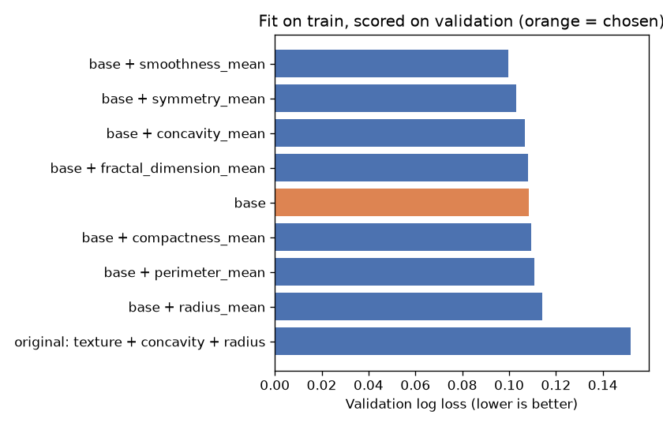
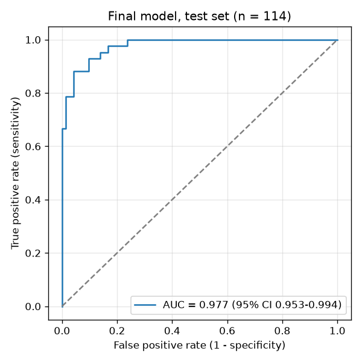

# Breast Cancer Diagnosis with Logistic Regression (Python)

[](https://github.com/lukahere007/breast-cancer-analysis-python/actions/workflows/ci.yml)

[](LICENSE)

> **This is the Python version.** The same analysis in R is in
> [breast-cancer-logistic-regression-analysi](https://github.com/lukahere007/breast-cancer-logistic-regression-analysi).

Can a small, interpretable logistic regression on the ten *mean* cell-nucleus features of the Breast Cancer Wisconsin (Diagnostic) dataset tell malignant from benign fine-needle aspirates? **Yes, fairly well.** Three features (texture, area and concave points) give a test AUC of 0.977 and catch 38 of 42 malignant tumours in a held-out test set the model never saw during selection. With only 114 test cases, those numbers carry real uncertainty (AUC 95% CI 0.953–0.994).

## Results (held-out test set, n = 114, 42 malignant)

| Metric | Value |
|---|---|
| Accuracy | 0.904 |
| Sensitivity (malignant caught) | 0.905 (38 / 42) |
| Specificity (benign cleared) | 0.903 (65 / 72) |
| ROC AUC | 0.977 (bootstrap 95% CI 0.953–0.994) |

Final model, fit on train + validation (original feature scale):

```
logit(p) = -17.63 + 0.356*texture_mean + 0.00755*area_mean + 111*concave_points_mean
```

Per standard deviation, the odds ratios are: texture 4.7, area 15.1, concave points 80.4. All three 95% CIs exclude 1.





## Method

1. **Data:** [UCI Breast Cancer Wisconsin (Diagnostic)](https://archive.ics.uci.edu/dataset/17/breast+cancer+wisconsin+diagnostic), 569 aspirates (357 benign, 212 malignant). Only the 10 `*_mean` features are used. The file is committed as `data/wdbc.csv`.
2. **Split:** stratified 60 / 20 / 20 into train, validation and test (`random_state=42`).
3. **Screening (train only):** fit a full 10-feature logistic regression and keep predictors with p < 0.05 as the base set. The VIFs reach more than 1,000 (radius, perimeter and area are r > 0.99), so this screen is unstable. The notebook shows this.
4. **Selection (validation):** try the base set plus each remaining feature. Fit each candidate on train and score it on validation by log loss, AUC and accuracy. Choose the lowest validation log loss, treating models within 0.01 as tied and preferring fewer features.
5. **Final evaluation (test, used once):** refit the chosen features on train + validation and report the confusion matrix, sensitivity, specificity, and AUC with a bootstrap CI.

Scaling happens inside a scikit-learn pipeline, so it is always fit on the rows the model is trained on.

## What changed from the first version

The first version of this notebook had problems that inflated or garbled its results:

- The final model was **fit on the 114-row validation set** rather than on the training data.
- The candidate feature sets were **copied from the R version's screening**, which used a different split. On this split, the training set does not single out `concavity_mean`.
- The README **swapped sensitivity and specificity** (it reported benign recall as sensitivity) and quoted an AUC of 0.9835, while the notebook printed 0.9825.
- `id` and an empty trailing CSV column were passed through the scaler, and the data path was a local `C:/Users/...` path.

For reference, the original texture + concavity + radius model is still included in the validation comparison. It does worse there (log loss 0.152 vs 0.108).

## Run it

```bash
git clone https://github.com/lukahere007/breast-cancer-analysis-python.git
cd breast-cancer-analysis-python
python -m venv .venv && source .venv/bin/activate   # Windows: .venv\Scripts\activate
pip install -r requirements.txt
jupyter lab breast_cancer_logistic_regression.ipynb
```

CI executes the notebook top to bottom on every push.

## Repository layout

```
├── breast_cancer_logistic_regression.ipynb   # the full analysis (executed, with outputs)
├── data/wdbc.csv                             # UCI WDBC data (569 rows)
├── figures/                                  # written by the notebook
├── requirements.txt
└── .github/workflows/ci.yml                  # runs the notebook on every push
```

## Limitations

- **Small test set.** One misclassified tumour moves sensitivity by about 2 points.
- **Unstable feature screening.** p-value screening on collinear features depends on the split. The R version, with a different random split, screens in texture + concavity and ends with a different final model (texture, concavity, concave points; test AUC 0.966). Both final models land in a similar performance range.
- **The 0.5 threshold is arbitrary.** A missed malignancy costs more than a false alarm, so a real screening tool would set the threshold for a target sensitivity.
- **Only the `_mean` features are used.** The `_se` and `_worst` features would likely help.
- **Not a clinical tool.** The data come from one centre and the model has not been externally validated.

## Author

Luke Wamalwa · [LinkedIn](https://www.linkedin.com/in/luke-wamalwa-839624292)
